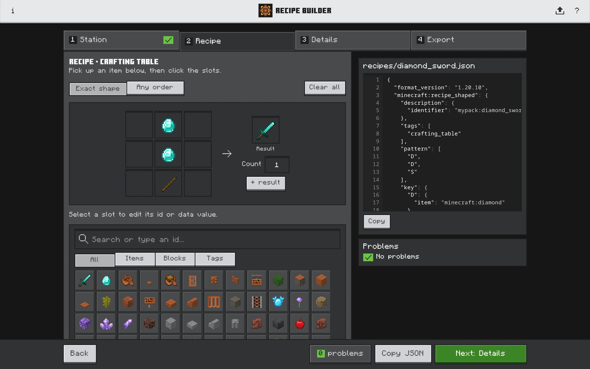
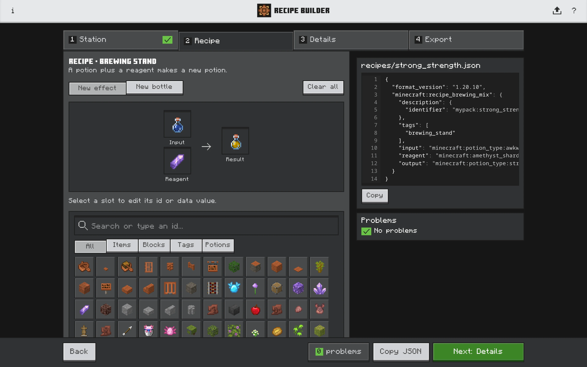
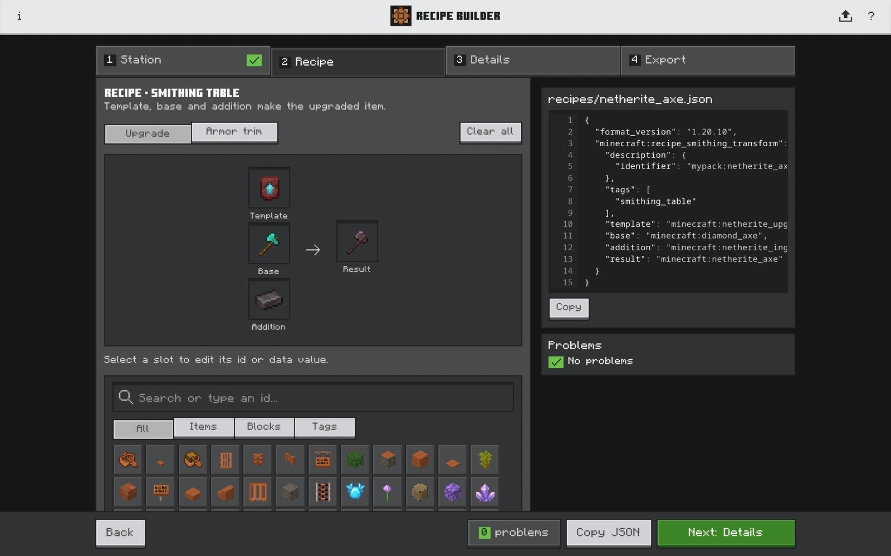
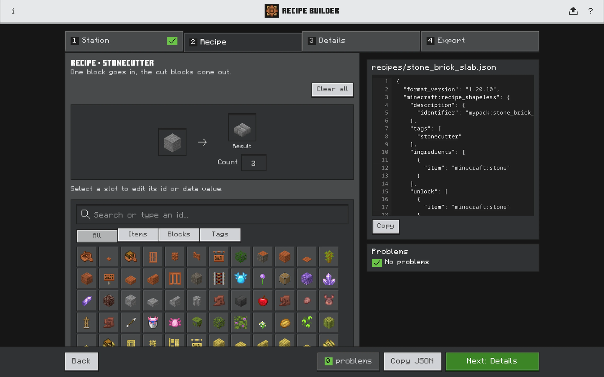

# Recipe Builder

A web builder for Bedrock recipe files. Pick a station, place items on the grid and export the recipe json or a ready pack.

**Open it:** https://duskaraa.github.io/recipe-builder/

## Features

- **Stations:** Crafting table, furnace, brewing stand, smithing table, stonecutter
- **Grid:** Exact shape or any order
- **Picker:** Only items the slot allows
- **Problems:** The same checks the game does
- **Export:** Json, .mcpack or pack + source

## Screenshots

Brewing stand: a potion plus a reagent makes a new potion.

Smithing: template, base and addition.

Stonecutter: one input, one result.

## About

Recipe Builder is a single HTML file with no install and no account. It runs fully in the browser; your files never leave your computer.

Made by [Duskaraa](https://duskaraa.github.io/).

Not an official Minecraft product. Not approved by or associated with Mojang or Microsoft.

## License

[MIT](LICENSE). Minecraft textures, fonts and screenshots belong to Mojang and are not covered by this license.
